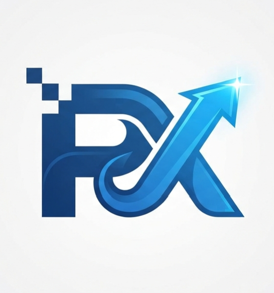
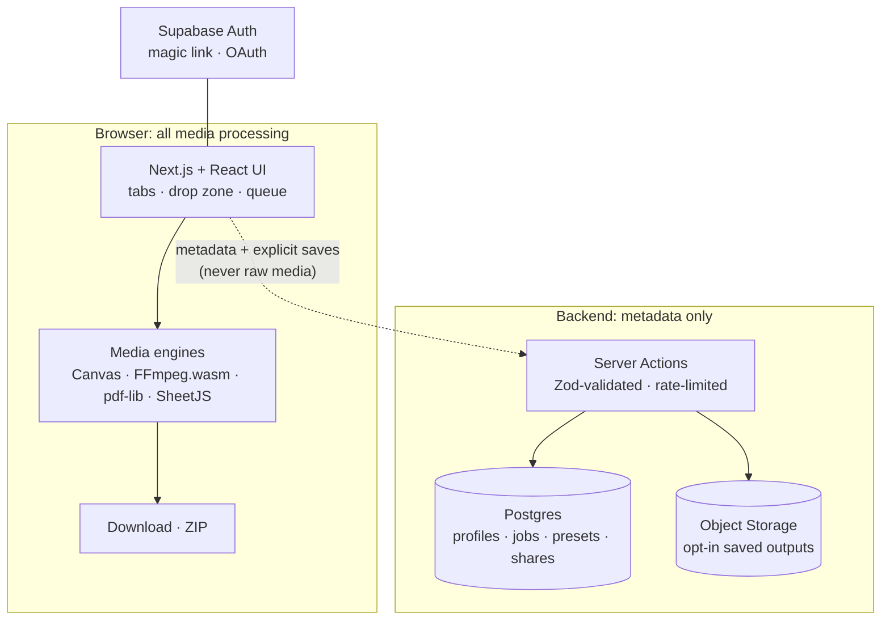
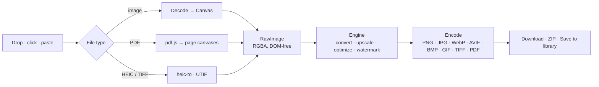
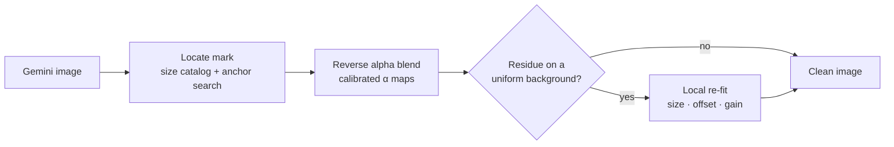
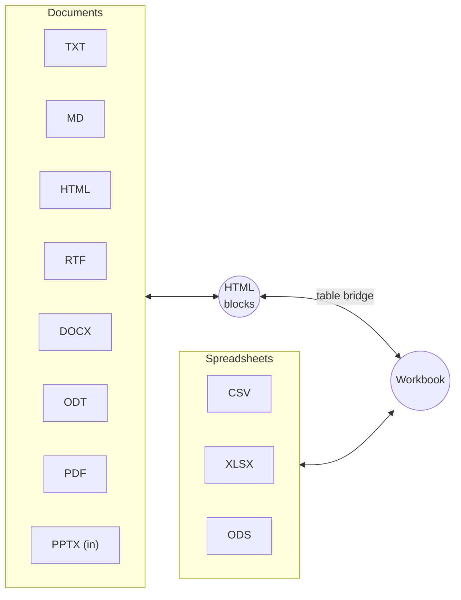

<div align="center">



# ProxiPixel

**A private media studio that runs entirely in your browser.**

Convert, upscale and compress images, transcode video, convert documents and edit PDFs,
all without your files ever leaving your device.

[](https://nextjs.org/)
[](https://react.dev/)
[](https://www.typescriptlang.org/)
[](https://tailwindcss.com/)
[](https://supabase.com/)
[](#quality)
[](./LICENSE)

[Features](#features) · [Architecture](#architecture) · [Getting started](#getting-started) · [Deployment](#deployment) · [Security](#security--privacy) · [Contributing](#contributing)

</div>

---

## Why ProxiPixel

Most online converters upload your files to someone else's server. ProxiPixel does the
work on your own device instead, using the Canvas API, WebAssembly and purpose-built
TypeScript engines.

| | |
| :--- | :--- |
| **Private by design** | Media is decoded, processed and encoded locally. Servers never receive it. |
| **Zero processing cost** | There is no transcoding backend to scale, because each visitor's browser does its own work. |
| **No install, no sign-up** | Every tool works signed out. An account only adds history, presets and a saved library. |
| **Supply-chain safe** | Every runtime library is pinned, vendored and served from the app's own origin. Nothing loads from a CDN. |

## Features

Seven tools in one workspace:

| Tool | Capability | Formats |
| :--- | :--- | :--- |
| **Convert** | Re-encode between image formats, including PDF ⇄ image | PNG · JPG · WebP · AVIF · BMP · GIF · TIFF · PDF · HEIC (input) |
| **Upscale** | Enlarge up to 4K UHD with gamma-correct Lanczos resampling, linear-light denoise, noise-gated clarity and thresholded sharpening | Any image, up to 3840 px on the long edge |
| **Optimize** | Compress to a target quality, or to a target file size found by binary search | AVIF · WebP · JPG, with an optional width cap |
| **Watermark** | Remove Gemini's visible logo by solving the alpha-blend equation, with no generative fill | PNG · JPG · WebP |
| **Video** | Transcode, trim, crop to an aspect ratio, change frame rate and mute, using FFmpeg.wasm | MP4 (H.264) · WebM (VP9) · GIF |
| **Documents** | Two-way conversion of documents and spreadsheets, bridged through tables | DOCX · ODT · RTF · PDF · MD · HTML · TXT · XLSX · CSV · ODS · PPTX (input) |
| **PDF tools** | Merge, split, remove, extract, reorder, rotate, crop margins and add page numbers | PDF |

**Every tool also includes:**

- **Batch queue** with per-file progress and one-click ZIP export
- **Before/after compare slider** for images and inline preview for video
- **Metadata stripping**: re-encoding removes EXIF data, and each result shows what was removed (GPS, camera, timestamps)
- **Accounts** (optional): job history, named presets, a private library of saved outputs and expiring share links
- **Accessibility**: full keyboard support for tabs, drop zones and sliders, plus System, Light and Dark themes

## Architecture

The browser does all of the media work. The backend is small, stateless and stores
metadata only.



### Design principles

1. **The engine is framework-independent.** Engine functions work on `RawImage`, a
   DOM-free RGBA buffer, so they run and are unit tested in plain Node.
2. **Heavy code loads on demand.** FFmpeg, pdf.js, the watermark engine and the document
   libraries load with dynamic `import()` the first time you use them, which keeps the
   first page load small.
3. **Media never reaches the server.** Only job metadata is recorded. Uploading an output
   is always something you do deliberately, one file at a time.
4. **The edge is hardened.** A strict Content-Security-Policy, Row Level Security and
   validation on every action are on by default.

### Image pipeline

All of the image tools share a single decode → transform → encode pipeline.



### Upscaling

Upscale is a four-stage pipeline that works in linear light, so averaging and blending
behave like physical light rather than gamma-encoded values:

1. **Denoise.** A radius-1 blend in linear light reduces sensor noise before it gets
   magnified.
2. **Lanczos (a = 3).** A separable resampler with weights normalized for each output
   sample, so flat colors stay exactly flat.
3. **Clarity.** A wide Gaussian unsharp mask boosts local contrast. A noise gate skips
   flat regions so JPEG blocking isn't amplified.
4. **Sharpen.** A thresholded Gaussian unsharp mask sharpens edges without halos.

### Watermark removal

Gemini applies its logo with standard alpha compositing. If you know the logo and its
alpha map, you can solve the blend equation exactly for the original pixels:

$$\text{original} = \frac{\text{watermarked} - \alpha \cdot \text{logo}}{1 - \alpha}$$



At native Gemini output sizes the removal is lossless. If an image has been resized, a
local re-fit cleans up any faint ghost that remains on a uniform background.

### Document conversion

Documents convert through an intermediate model of HTML blocks, and spreadsheets through a
SheetJS workbook. A table bridge connects the two, so conversions such as `XLSX → Markdown`
or `HTML table → CSV` work directly.



## Tech stack

| Layer | Technology |
| :--- | :--- |
| Framework | Next.js 16 (App Router, Server Actions, React Server Components), React 19 |
| Language | TypeScript (strict) |
| Styling | Tailwind CSS 4, CSS custom properties, `light-dark()` theming |
| Image engine | Canvas API; Lanczos, Gaussian unsharp mask, BMP encoder and size optimizer written in TypeScript |
| Video | FFmpeg.wasm (loaded on demand) |
| Documents & PDF | SheetJS, mammoth, docx, marked, turndown, jszip, pdf-lib, pdf.js, jsPDF |
| Backend | Supabase (Postgres, Auth, Storage), Drizzle ORM, Zod |
| Platform | Upstash Redis rate limiting, Sentry error tracking (both optional) |
| Tooling | pnpm, ESLint 10, Prettier, Vitest, Playwright, Lighthouse CI, Dependabot |

## Project structure

```text
.
├── app/                 Next.js App Router: studio, login, library, presets, public shares
├── components/          React UI: studio shell, tool panels, queue, compare, auth
├── lib/
│   ├── engine/          Framework-independent media engine (image, video, PDF, watermark)
│   ├── docs/            Document and spreadsheet conversion hub
│   ├── app/             Client state, processing dispatch, downloads, theming
│   └── supabase/        Browser, server and admin clients
├── server/              Server Actions: jobs, presets, outputs, shares, validation, rate limits
├── db/                  Drizzle schema, SQL migrations, RLS and storage policies
├── tests/               Vitest unit and integration tests
├── e2e/                 Playwright suites and generated sample fixtures
└── tools/               Build-time asset vendoring
```

## Getting started

### Prerequisites

- **Node.js** 22.12 or newer
- **pnpm** 10 (`corepack enable` picks up the pinned version)
- **Supabase** project (optional). You only need it for accounts, history and the
  library. Every tool works without it.

### Install and run

```bash
git clone https://github.com/Premchand006/ProxiPixel.git
cd ProxiPixel
pnpm install
cp .env.example .env.local
pnpm dev                     # → http://localhost:3000
```

`pnpm install` runs a postinstall step that copies the pinned runtime libraries
(FFmpeg.wasm, pdf.js and others) into `public/vendor/`.

### Configuration

| Variable | Required | Purpose |
| :--- | :---: | :--- |
| `NEXT_PUBLIC_SUPABASE_URL` | for accounts | Supabase project URL |
| `NEXT_PUBLIC_SUPABASE_ANON_KEY` | for accounts | Public anon key |
| `SUPABASE_SERVICE_ROLE_KEY` | for accounts | Server-only key. Never expose it to the client. |
| `DATABASE_URL` / `DIRECT_URL` | for accounts | Pooled runtime connection / direct connection for migrations |
| `NEXT_PUBLIC_SITE_URL` | yes | Public base URL, used for auth redirects |
| `UPSTASH_REDIS_REST_URL` / `_TOKEN` | no | Distributed rate limiting. Falls back to an in-memory limiter. |
| `NEXT_PUBLIC_SENTRY_DSN` | no | Error tracking. Add `SENTRY_ORG`, `SENTRY_PROJECT` and `SENTRY_AUTH_TOKEN` for source maps. |

### Database setup (optional)

```bash
pnpm drizzle:migrate
```

Then run `db/policies.sql`, `db/auth-setup.sql` and `db/storage-setup.sql` in the Supabase
SQL editor to enable Row Level Security, auth triggers and the private storage bucket.

## Deployment

ProxiPixel deploys as a standard Next.js app.

- **Vercel**: import the repository, set the environment variables, and deploy. No extra
  config is needed.
- **Netlify**: `netlify.toml` is included and uses the official Next.js runtime. The
  request proxy runs as an Edge Function.

Set `NEXT_PUBLIC_SITE_URL` to the production URL, and add it to the Supabase Auth
redirect allow-list.

## Quality

| Command | What it runs |
| :--- | :--- |
| `pnpm test` | 86 Vitest unit tests covering the engines, server actions and document conversions |
| `pnpm test:e2e` | 38 Playwright tests in real Chromium against real sample files, covering every tool |
| `pnpm verify` | Typecheck → lint → unit tests → production build |

Every push and pull request goes through these continuous integration gates:

- typecheck, lint, unit tests and a production build
- a production-dependency audit (high or critical findings fail the build)
- Lighthouse CI with a Core Web Vitals budget
- the full Playwright end-to-end suite

Dependabot opens grouped dependency updates every week.

The end-to-end suite checks output bytes and MIME types for every image input → output
pair, every document conversion, the FFmpeg video pipeline and the PDF tools. Headless
Chromium has no AVIF encoder, so AVIF output and heavy VP9 encoding are covered by unit
tests of the encoders and argument builders instead.

## Security & privacy

- **On-device processing.** No server and no third party ever receives your media.
- **Same-origin runtime.** Every media library is a pinned npm dependency that is vendored
  at build time. Nothing is fetched from a CDN.
- **Metadata-only storage.** The database records job details (tool, format, size,
  options, timestamp), never file contents.
- **Explicit uploads only.** A file reaches your private storage bucket only when you
  click **Save**.
- **Row Level Security.** Each user can read and write only their own rows. Share links
  are signed and expire.
- **Hardened server.** Every Server Action validates its input with Zod, gets the user's
  identity from the session and is rate-limited.
- **Strict headers.** The app sets a Content-Security-Policy, `X-Frame-Options: DENY`, a
  locked-down `Permissions-Policy` and a strict referrer policy.

## Known limitations

- **Upscale** uses classical resampling. It enhances the detail already in the image, but
  it can't invent new detail the way a trained super-resolution model does.
- **Watermark** removes only Gemini's visible corner logo. It does not affect invisible
  watermarks such as SynthID.
- **Documents** can import `.pptx` but not export it, and legacy `.ppt` is not supported.
  Full Office fidelity would need server-side LibreOffice, which goes against the
  no-upload design.
- **PDF tools** work on whole pages. They don't edit or reflow the text inside a page.

## Contributing

Contributions are welcome. Before you open a pull request:

1. Create a feature branch from `main`.
2. Run `pnpm verify` and make sure typecheck, lint, tests and the build all pass.
3. Add or update tests for any engine or server change.
4. Keep pull requests focused, and write a clear description of the change.

## Acknowledgments

- The watermark engine (`lib/engine/watermark/vendor/`) is a vendored build of
  [gemini-watermark-remover](https://github.com/GargantuaX/gemini-watermark-remover) by
  GargantuaX, a JavaScript port of
  [Gemini Watermark Tool](https://github.com/allenk/GeminiWatermarkTool) by Allen Kuo.
  Both are MIT licensed. The reverse-alpha method and calibrated masks are © their
  authors.
- Built on [Next.js](https://nextjs.org/), [Supabase](https://supabase.com/),
  [FFmpeg.wasm](https://ffmpegwasm.netlify.app/), [SheetJS](https://sheetjs.com/),
  [pdf-lib](https://pdf-lib.js.org/), [mammoth.js](https://github.com/mwilliamson/mammoth.js),
  [docx](https://docx.js.org/) and [heic-to](https://github.com/hoppergee/heic-to).

## License

Released under the [MIT License](./LICENSE). Vendored components keep their original
licenses and attribution.
